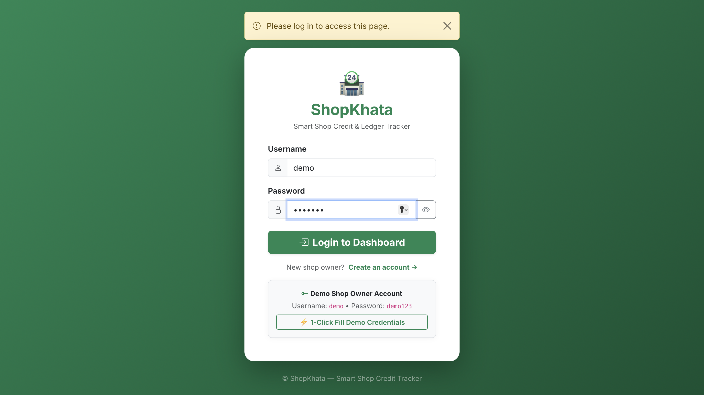
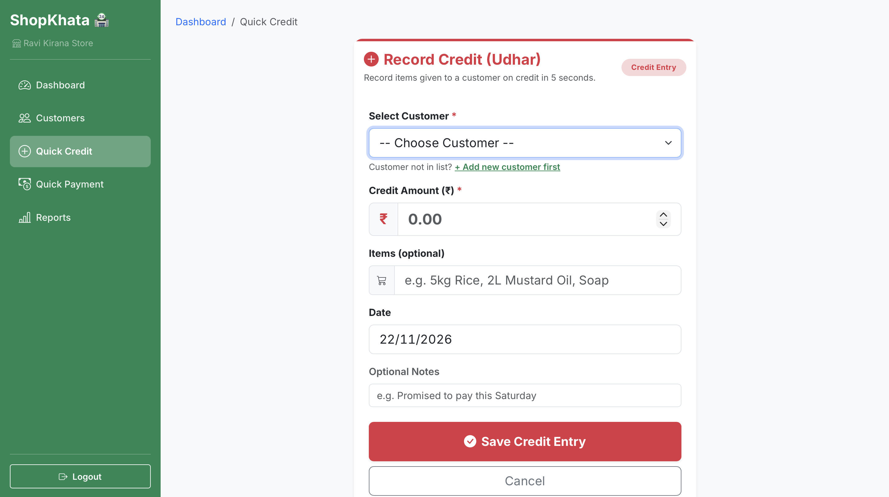
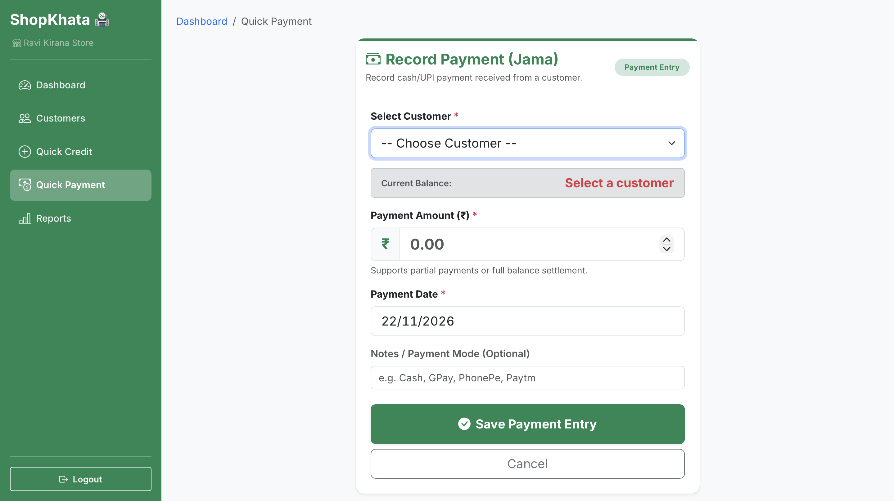
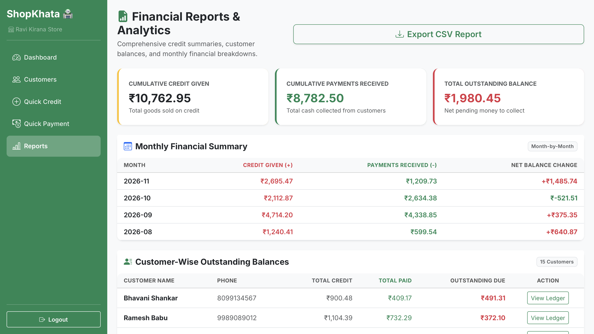

# ShopKhata – Shop Credit Tracker for Ravi

A small, mobile-first web app that replaces the paper *khata* notebook of a neighbourhood grocery shop.

## 1. The Problem and the User

**User:** Ravi runs a small grocery shop in Hyderabad and gives goods on credit to about 80 regular customers. He uses a smartphone every day, reads simple English, is not comfortable with complicated apps, and is usually busy with a customer standing at the counter.

**His problems (from the brief):**

* *"I forget who owes me how much. Sometimes I lose the money completely."*
* *"Customers argue: 'I paid you last week!' I have no proof."*
* *"Asking people to pay is awkward. I don't remind them, so they delay."*
* *"At the end of the month I don't know how much money is stuck with customers."*

I tried to address all four, but kept each solution small.

| Ravi's problem | How ShopKhata solves it |
| --- | --- |
| Forgets who owes what | Customer list sorted by who owes most; search by name or phone; dashboard shows total outstanding and top debtors |
| *"I paid last week!"* | Every credit and payment is saved with a date and a unique entry ID. Each customer has a ledger with a running balance, so Ravi can show the exact history |
| Awkward to ask for money | One tap on a customer opens WhatsApp with a polite, pre-filled reminder that includes the amount |
| Month-end: how much is stuck? | Dashboard + Reports page: total credit given, total received, total outstanding, month-by-month summary, and a CSV download |

## 2. What I Built

* **Authentication & Multi-Shop Isolation:** Login / logout, with a separate private set of data for each shop (all queries are scoped to the logged-in `user_id`).
* **Customer Management:** Add, edit, search, view ledger, and delete (only allowed when the customer's balance is zero).
* **Quick Credit & Quick Payment screens:** Only *customer* and *amount* are needed; the date defaults to today and the item description is optional, so an entry takes just a few seconds at the counter.
* **Per-customer Ledger:** Complete transaction history with running balance and unique entry IDs.
* **WhatsApp Reminder Link:** Opens a pre-filled payment reminder message (nothing is sent automatically).
* **Dashboard & Monthly Reports:** Visual summaries using Chart.js, monthly breakdowns, and CSV export.
* **Mobile-first Layout:** Built with Bootstrap 5 featuring large buttons and touch-friendly inputs.
* **Demo Data & Automated Tests:** Seed script with 15 Hyderabad customers and ~80 entries, plus 18 automated unit tests covering auth, CSRF, tenant isolation, money rules, input validation, XSS/SQL-injection checks, and regressions.

### Deliberately Left Out (and Why)

| Left out | Reason |
| --- | --- |
| SMS / automatic WhatsApp sending | Needs paid APIs; the brief specifies no outside integrations. A click-to-chat link needs no API key |
| Editing / deleting individual entries | A ledger that can be silently edited weakens the "proof" Ravi needs. A wrong entry should be fixed with a new correcting entry (see next steps) |
| Inventory, billing, GST | Different product; would clutter the UI and hide the core workflow Ravi needs |
| Staff accounts / roles | v1 is scoped for a single shop owner |
| Telugu / Hindi UI | Ravi reads simple English; regional language support is a logical next step |
| Cloud Hosting | Not required; the app is built to run locally with zero external dependencies |

## 3. Application Screenshots

### Login Page


### Dashboard


### Customer Management


### Quick Credit


### Quick Payment


### Reports


## 4. Assumptions and Product Decisions

* **Dynamic Balances:** All amounts are in rupees (₹). Balance is never stored; it is always calculated as total credit − total payments, so it cannot drift out of sync.
* **Overpayment Guard:** A payment cannot be larger than what the customer currently owes (prevents typing mistakes such as an extra zero). Advance payments are not supported in v1.
* **Debt Protection:** Customers with a non-zero balance cannot be deleted; this prevents accidental loss of debt records.
* **Optional Phone Numbers:** Phone numbers are validated as 10-digit Indian mobile numbers (optional). A customer without a phone number simply has no WhatsApp button.
* **Unique Entry IDs:** Generated on the server (timestamp + random digits) and enforced as unique in the database.
* **Fast Counter Entry:** Item description is optional (defaults to "Goods on credit" if left blank), because typing at the counter is the slowest part.
* **Local Dates:** Dates are stored as plain `YYYY-MM-DD` strings in the shop's local time.
* **Open Registration:** Registration is enabled so a reviewer can create a second shop account and verify multi-tenant data isolation.
* **Internet Note:** Bootstrap, Bootstrap Icons, Chart.js, and the Inter font are loaded from a CDN, so the browser needs internet for styling and charts. All data and backend logic stay 100% local. Vendoring these assets for offline use is noted in next steps.

## 5. Tech Stack and Why

| Layer | Choice | Why |
| --- | --- | --- |
| Backend | Python 3 + Flask | Lightweight, easy to read, quick to run locally |
| Database | SQLite (`sqlite3`, plain SQL) | Zero setup; single file; ideal for a shop with ~80 customers. No ORM so every query is transparent and explicitly scoped by `user_id` |
| Frontend | Server-rendered Jinja2 templates, Bootstrap 5, Vanilla JS, Chart.js | No build step; responsive on mobile devices; fewer moving parts |
| Security | Werkzeug password hashing, Flask-WTF CSRF, session login, parameterised SQL | Industry-standard, well-tested protections |

## 6. Installation and Setup Guide

### Prerequisites

* Python 3.8 or higher
* Git

### Clone and Create Virtual Environment

```bash
git clone https://github.com/rajdeeppatil77/ShopKhata.git
cd ShopKhata
python -m venv venv

```

Activate the virtual environment:

**macOS / Linux:**

```bash
source venv/bin/activate

```

**Windows:**

```bash
venv\Scripts\activate

```

### Install Dependencies, Seed Database, and Run

```bash
pip install -r requirements.txt
python seed.py
python app.py

```

Open `[http://127.0.0.1:5001](http://127.0.0.1:5001)` in your browser (port `5001` is used by default because macOS AirPlay occupies port `5000`; override it anytime with `PORT=8000 python app.py`).

* **Demo Login:** Username `demo` | Password `demo123` (Shop: *Ravi Kirana Store*)
* **Test on Mobile (same Wi-Fi):** Run `HOST=0.0.0.0 python app.py`, then open `http://YOUR-COMPUTER-IP:5001` on your phone. The server binds to localhost by default for security.
* **Reset Data:** Data is stored in `instance/shopkhata.db` and persists across restarts. Delete that file and re-run `python seed.py` to reset.

### Running Tests

The automated test suite uses an isolated temporary database and will not touch your demo data:

```bash
python -m unittest discover -s tests

```

## 7. Project Structure and Database

```text
ShopKhata/
├── app.py                              # Application entry point & Flask app factory
├── config.py                           # Configuration settings & secret key management
├── seed.py                             # Database initializer with demo shop & sample data
├── requirements.txt                    # Python dependencies
├── README.md                           # Project documentation
├── AI_LOG.md                           # AI assistance log
├── .gitignore                          # Git ignore rules
├── instance/
│   ├── .gitkeep
│   ├── secret_key                      # Auto-generated local secret key (gitignored)
│   └── shopkhata.db                    # Local SQLite database (auto-generated, gitignored)
├── screenshots/
│   ├── login.png
│   ├── dashboard.png
│   ├── customers.png
│   ├── quick-credit.png
│   ├── quick-payment.png
│   ├── ledger.png
│   └── reports.png
├── shopkhata/                          # Core application package
│   ├── __init__.py
│   ├── auth.py                         # Login, registration, logout routes
│   ├── customers.py                    # Customer CRUD & ledger views
│   ├── dashboard.py                    # Main summary dashboard & metrics
│   ├── models.py                       # Database schema & SQL query helpers
│   ├── reports.py                      # Monthly summaries & CSV export
│   ├── transactions.py                 # Quick credit & payment recording
│   ├── utils.py                        # Entry ID generation, formatting & validators
│   └── templates/                      # Jinja2 HTML templates
├── static/                             # Frontend static assets
│   ├── css/
│   │   └── style.css                   # Custom styles & mobile-friendly overrides
│   └── js/
│       └── main.js                     # Frontend interactions & UI helpers
└── tests/                              # Automated unit & security test suite
    ├── test_audit.py                   # Audit trail & data integrity tests
    ├── test_regressions.py             # Regression tests for key workflows
    └── test_security_and_edge_cases.py # Auth, CSRF, isolation, XSS/SQLi & edge cases

```

### Database Schema

```text
users                 id, username (unique), password_hash, shop_name, created_at
customers             id, user_id → users, full_name, phone, address, created_at
credit_transactions   id, txn_id (unique), customer_id → customers, user_id → users,
                      description, amount (> 0), txn_date, notes, created_at
payment_transactions  id, txn_id (unique), customer_id → customers, user_id → users,
                      amount (> 0), txn_date, notes, created_at

```

Outstanding balance is calculated dynamically at query time:

$$\text{Outstanding Balance} = \sum \text{credit\_transactions.amount} - \sum \text{payment\_transactions.amount}$$

## 8. What I Would Build Next

* **Correction & Void Entries:** Support reversal/adjustment entries with a mandatory reason rather than allowing silent edits to ledger history.
* **Shareable Customer Statements:** A printable / WhatsApp-friendly ledger view per customer to resolve disputes cleanly.
* **Overdue Tracking View:** Filter customers who haven't made a payment in 30+ days, with one-tap reminder actions.
* **Integer Paise Storage:** Store currency amounts as integer paise instead of floating-point numbers to eliminate rounding edge cases at scale.
* **Searchable Customer Picker & Quick Amounts:** Replace standard dropdowns with a searchable selector for 80+ customers and add quick-amount presets for faster counter entry.
* **Offline PWA & Regional Languages:** Bundle Bootstrap/Chart.js locally for offline support, add Progressive Web App (PWA) installability, and support Telugu/Hindi labels.
* **Auth Hardening:** Add login rate limiting and a password-reset flow.

## 9. Time Spent

Approx. 12 hours (~2 hrs product scoping & schema design, ~6 hrs backend routes, SQL queries & mobile-first UI, ~2.5 hrs writing 18 automated unit/security tests & seed data, ~1.5 hrs edge-case polish & documentation).

## 10. Developer Information

* **Developer:** Rajdeep Patil
* **GitHub:** [https://github.com/rajdeeppatil77](https://github.com/rajdeeppatil77)
* **Project:** ShopKhata